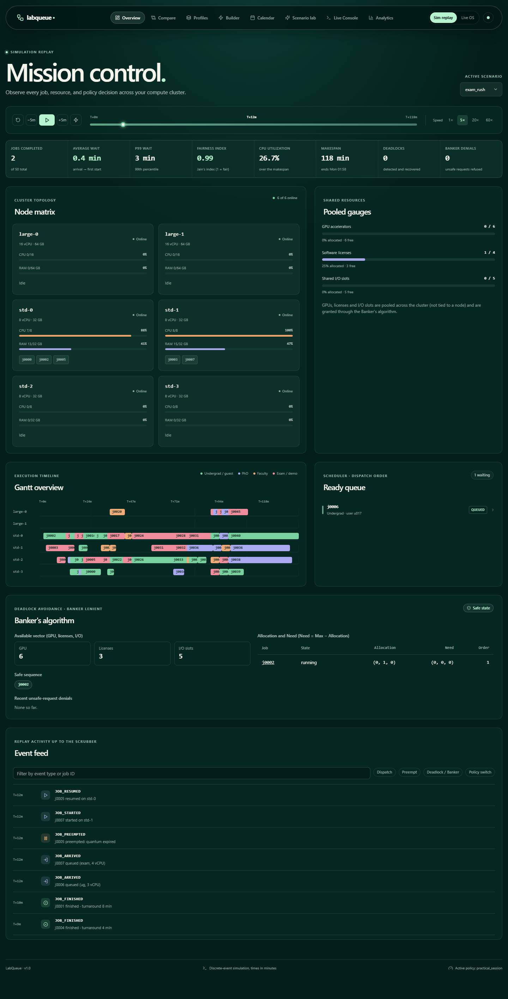
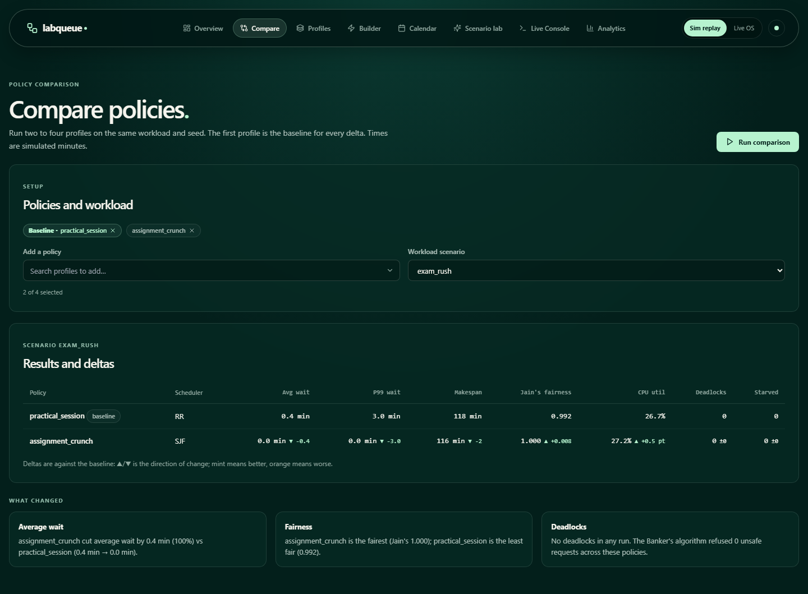
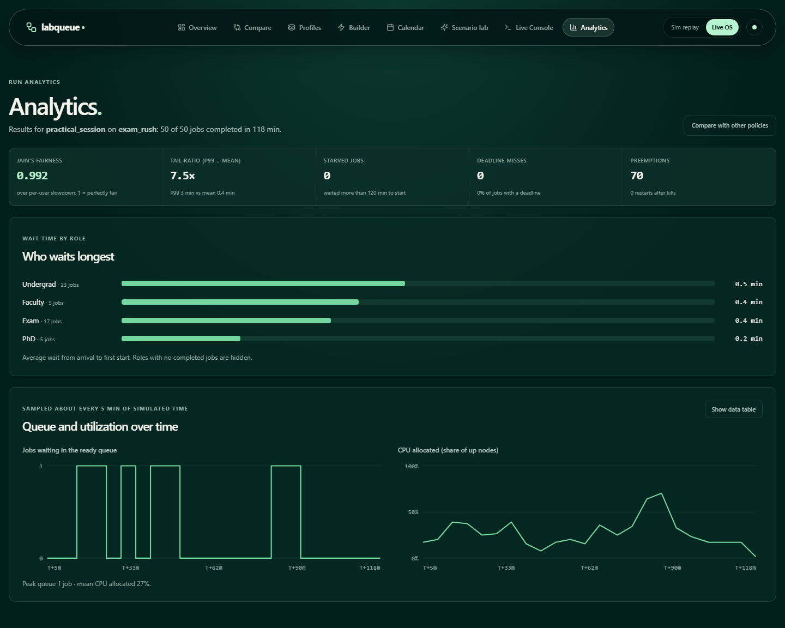
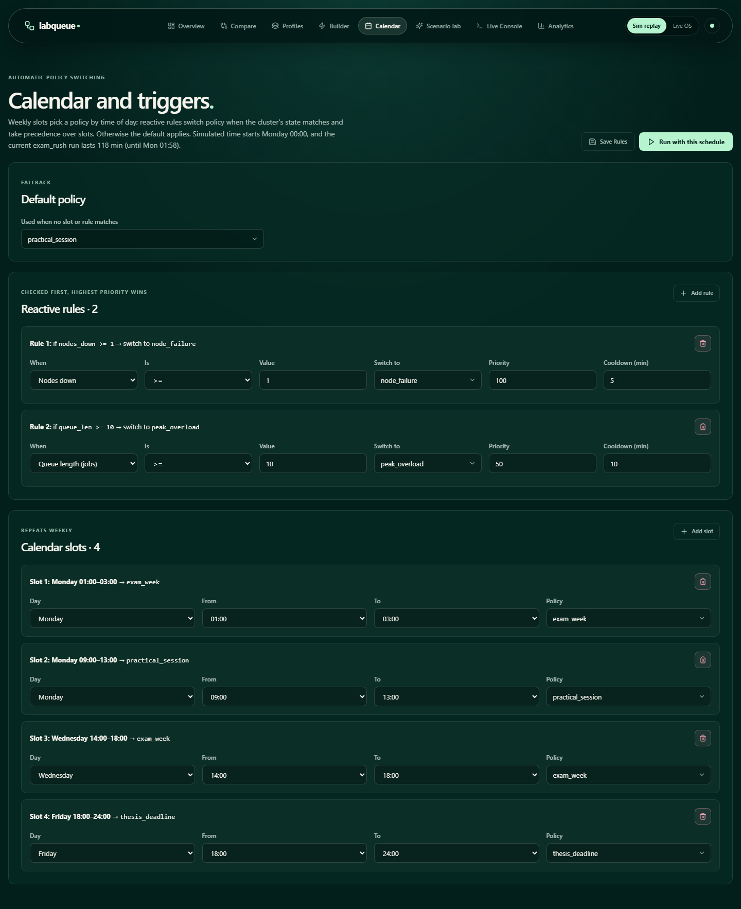
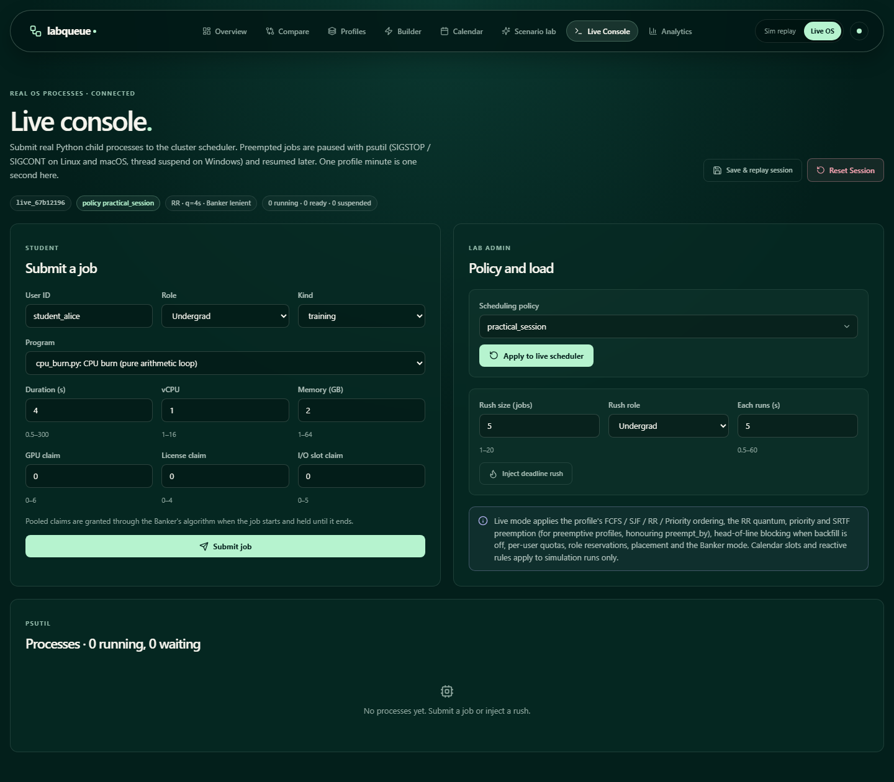
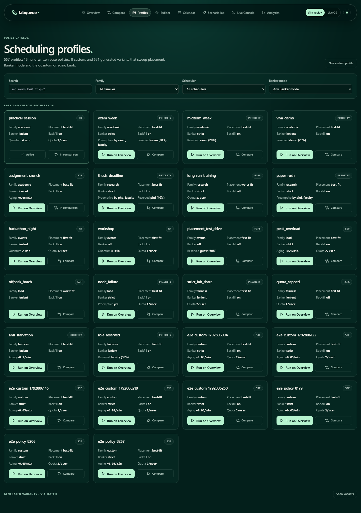
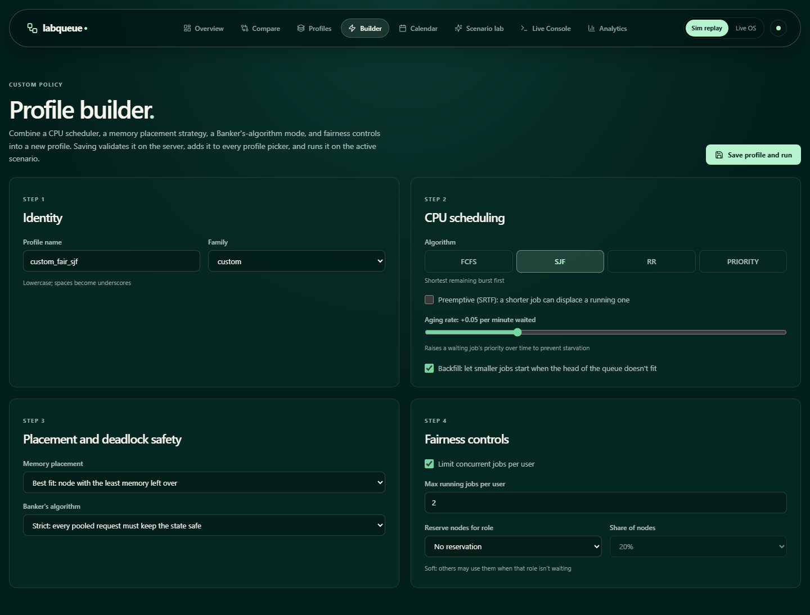
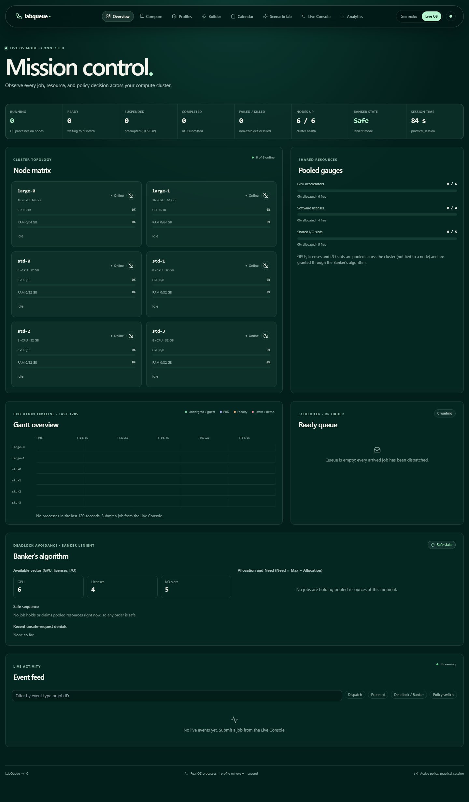
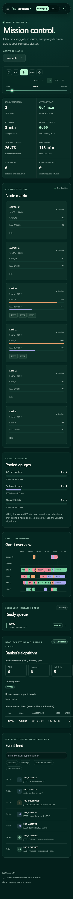

# LabQueue: Policy-Based Job Scheduling for Shared Compute Labs

**Operating Systems capstone project.** LabQueue compares CPU scheduling policies (FCFS, SJF/SRTF,
Round-Robin, Priority with aging), memory placement (first / best / worst fit) and Banker's-algorithm
deadlock avoidance on a simulated six-node lab cluster. A **Live mode** runs the same policies against
real OS child processes, pausing and resuming them for preemption.



---

## What's inside

| Part | Where | What it does |
| --- | --- | --- |
| Discrete-event engine | `backend/engine/` | Deterministic simulation in integer **minutes**: arrivals, dispatch, preemption, pooled-resource phases, node outages, deadlock detection and recovery, calendar/trigger policy switching. |
| Live runner | `backend/live/` | Spawns real Python processes (`cpu_burn.py`, `matrix_mult.py`, `prime_sieve.py`, `hash_files.py`, `monte_carlo_pi.py`, `sleep_io.py`) and schedules them in wall-clock **seconds**. |
| API | `backend/app/` | FastAPI + SQLite (SQLModel). REST under `/api`, live updates over the `/ws/live` WebSocket. |
| Dashboard | `frontend/` | React 18 + TypeScript + Vite + Tailwind + Zustand. |

### Cluster model

`engine/model.py` defines the default cluster:

- **2 large nodes** (`large-0`, `large-1`): 16 vCPU, 64 GB each.
- **4 standard nodes** (`std-0` … `std-3`): 8 vCPU, 32 GB each.
- **Pooled resources** shared by the whole cluster (not attached to any node): 6 GPUs, 4 software
  licenses, 5 shared I/O slots. Jobs claim these in phases, and requests go through the Banker's algorithm.

### Profiles

A profile bundles a scheduler, quantum, preemption (`preemptive`, `preempt_by`), aging, priority weights,
placement, Banker mode (`strict` / `lenient` / `off`), per-user quota, soft role reservation and backfill.

- **18 hand-written base profiles** in five families:
  - academic: `practical_session` (RR q=4), `exam_week`, `midterm_week`, `viva_demo`, `assignment_crunch` (SJF)
  - research: `thesis_deadline`, `long_run_training` (FCFS), `paper_rush`
  - events: `hackathon_night` (RR q=2), `workshop` (RR q=8, Banker off), `placement_test_drive` (FCFS, Banker off)
  - load: `peak_overload`, `offpeak_batch`, `node_failure`
  - fairness: `strict_fair_share`, `quota_capped`, `anti_starvation`, `role_reserved`
- **531 generated variants** that sweep placement × Banker mode × one knob (quantum 2/4/8 for RR,
  aging 0/0.05/0.1/0.2 otherwise), de-duplicated by configuration. The API serves all **549** built-in
  profiles plus any custom ones (`GET /api/profiles`). Variant names such as
  `practical_session[first|off|q2]` are shown in the UI as `practical_session · first-fit · Banker off · q=2`.
- **Custom profiles** are created in the Builder (`POST /api/profiles/custom`). Names must be unique: a
  name that matches a built-in or existing profile returns 409.

### Simulation events

The engine emits (`engine/events.py`): `JOB_ARRIVED`, `JOB_STARTED`, `JOB_PREEMPTED`, `JOB_RESUMED`,
`JOB_FINISHED`, `JOB_KILLED`, `PHASE_REQUEST`, `PHASE_GRANTED`, `PHASE_BLOCKED`, `REQUEST_DENIED_UNSAFE`,
`DEADLOCK_DETECTED`, `DEADLOCK_RECOVERED`, `NODE_DOWN`, `NODE_UP`, `PROFILE_SWITCHED`, plus the bookkeeping
rows `QUEUE_STATE` and `STATE_SNAPSHOT` (hidden in the UI).

Live mode emits its own vocabulary (`JOB_SUBMITTED`, `JOB_DISPATCHED`, `JOB_COMPLETED`, `JOB_FAILED`,
`BANKER_DENIED`, `NODE_FAILED`, `NODE_RESTORED`, …). **Save & replay session** maps a live session onto the
simulator's names so it can be replayed, with times kept in seconds.

### Calendar and reactive rules

Saved under `PUT /api/calendar`. Weekly **slots** choose a policy by time of day, and **reactive rules**
(`queue_len`, `nodes_down`, `util`, `running_count`, `min_slack`) switch policy when the cluster's state
matches. Rules take precedence over slots, and the default policy applies otherwise. The server rejects
slots with start ≥ end, unknown condition fields, and references to profiles that don't exist.
Simulated time starts **Monday 00:00**, so only slots inside a run's makespan can matter. Use
**Calendar → Run with this schedule** (`POST /api/runs` with `"use_schedule": true`) to drive a run with
it. Policy switches appear as lavender markers on the scrubber and in the event feed.

### Live mode

Live mode applies the profile's FCFS / SJF / RR / Priority ordering (submission order breaks ties), the
RR quantum (1 profile minute = 1 second), priority and SRTF preemption for `preemptive` profiles
(honouring `preempt_by`), head-of-line blocking when backfill is off, quotas, role reservations,
placement, and the Banker mode. Preempted processes are paused with `psutil.Process.suspend()` (SIGSTOP on
Linux/macOS, thread suspension on Windows) and keep their pooled allocation until they finish.
Calendar slots and reactive rules apply to simulation runs only. Request limits are served by
`GET /api/live/limits`: vCPU and memory up to the largest node, GPU/license/I/O claims up to the pool size.

---

## Running it

Requirements: Python 3.11+ and Node 18+.

```bash
# backend
cd backend
python -m venv .venv
.venv/bin/pip install -r requirements.txt        # Windows: .venv\Scripts\pip
.venv/bin/uvicorn app.main:app --port 8000

# frontend (second terminal): http://localhost:5173, proxies /api and /ws to :8000
cd frontend
npm install
npm run dev
```

To serve everything from port 8000, run `npm run build` once; the backend serves `frontend/dist` when it
exists.

The SQLite database (`backend/labqueue.db`) is created and seeded on startup and is not committed.
Configuration via environment variables:

| Variable | Default | Purpose |
| --- | --- | --- |
| `LABQUEUE_DATABASE_URL` | `sqlite:///<backend>/labqueue.db` | Database location (tests use a temp file). |
| `LABQUEUE_CORS_ORIGINS` | `http://localhost:5173,http://127.0.0.1:5173` | Comma-separated origins allowed to call the API directly. |

### Tests

```bash
cd backend
.venv/bin/python -m pytest
```

102 tests: the original stage suites (`test_stage0` … `test_stage9`, models through live mode), plus
`test_api_validation.py` (profile names, calendar validation, scenario errors, schedule-driven runs, CORS)
and `test_live_runner.py` (RR with pooled resources, FIFO ordering, kill/fail/restore semantics, in-place
reset, bounded event log, priority preemption, request limits, replayable saves).

`python scripts/demo.py` runs a CLI walkthrough of the engine and a live process.

---

## Screens

| | |
| --- | --- |
|  **Compare**: two to four policies on one workload, deltas against a baseline, findings computed from the results. |  **Analytics**: wait by role, queue length and CPU utilization over time. |
|  **Calendar**: slots and reactive rules with inline validation. |  **Live console**: submit real processes, switch policy, inject a rush. |
|  **Profiles**: base and custom profiles first, variants on demand. |  **Builder**: compose and validate a custom profile. |
|  **Overview in Live OS mode**: live KPIs, nodes, Gantt, Banker state and events. |  **390 px**: the navigation collapses into a menu. |

---

## Demo walkthrough

1. **Overview**: pick a scenario and press **Play** (Space; ←/→ step 5 min, Shift for 15). Watch the
   node matrix, Gantt, ready queue, and the **Banker's algorithm** panel (Available vector,
   Allocation/Need per job, safe sequence). Click any job for the inspector.
2. **Compare**: add `assignment_crunch` (SJF) and `exam_week` (Priority) next to `practical_session` and run.
   The table shows deltas against the baseline, and "What changed" summarises them.
3. **Profiles → Builder**: save a custom profile; it runs immediately and appears in every profile picker.
4. **Calendar**: load the example schedule, save, then **Run with this schedule** and look for
   `PROFILE_SWITCHED` markers on the scrubber.
5. **Live Console**: with `practical_session` (RR, q = 4 s), submit a 7-second job with a GPU claim plus a
   few 16-vCPU jobs so the large nodes are contended. Watch preemption and resumption in the event feed,
   switch Overview to **Live OS**, then **Save & replay session**.

## Known issues

These are **engine** defects. They were found during the 2026-10 review and left unchanged, because
fixing them changes simulation semantics:

- **Results are not reproducible across processes.** The engine iterates Python `set`s of job-id strings
  (e.g. `eligible_set`), and their order depends on hash randomisation. The same seed gives identical
  results within one server process, or with a fixed `PYTHONHASHSEED`, but can differ after a restart.
  Iterating sorted ids would fix it (and change current results).
- **Some profile/workload combinations crash** with `ValueError: Cannot go back in time`. Examples with
  50 jobs and seed 42: `workshop` on `balanced_day`, `thesis_deadline` on `thesis_week`. A job's finish
  event is scheduled in the past (negative remaining time), most likely after it was blocked on a
  pooled-resource phase when its finish fired. The API reports this as a readable error instead of a bare 500.
